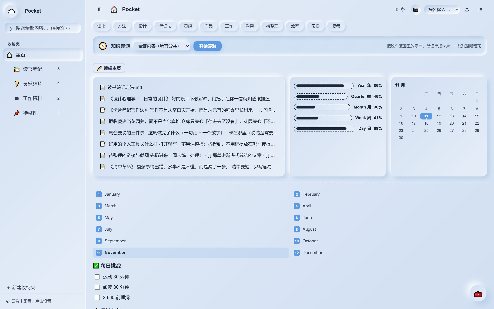
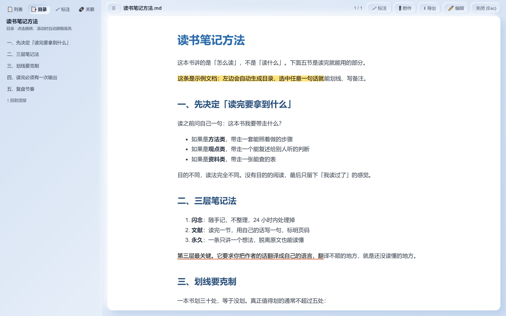
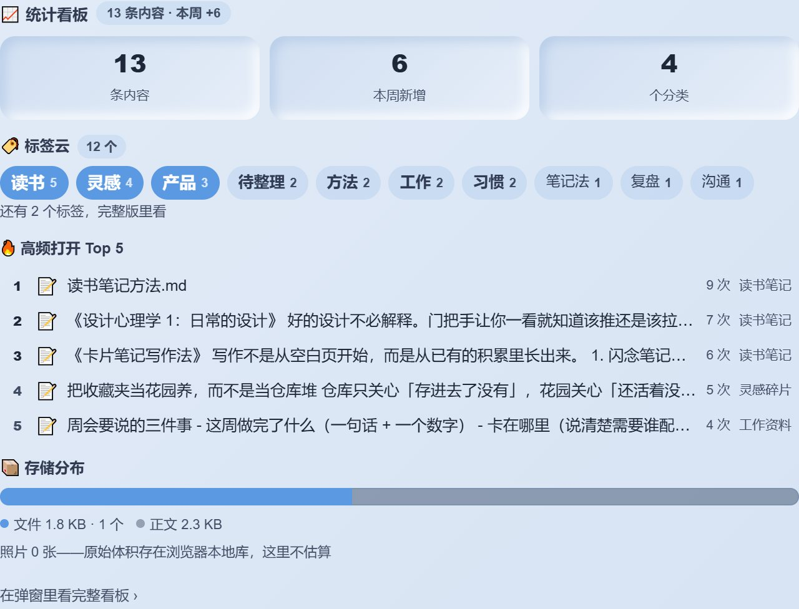
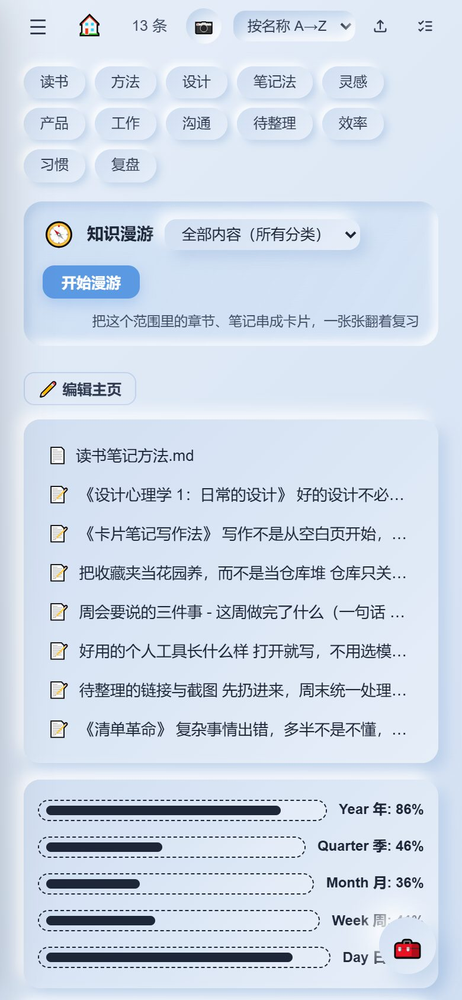

# Pocket

把笔记、文件、照片、待办收在一处的个人知识空间。

纯静态前端：没有构建步骤，没有 npm 依赖，没有账号系统。双击 `index.html` 就能用，数据只存在自己浏览器的 localStorage 与 IndexedDB 里。

> 左上角那个名字是「空间名」，在设置里随时能改，不是项目名。



<p align="center">
  
  
</p>
<p align="center">
  
</p>

## 能做什么

**收东西**

- 笔记（Markdown 快捷键）、文件（HTML / PDF / Markdown / 文本 / docx）、照片、链接、随手拍
- 拖拽上传、粘贴截图、批量选择与移动
- 分类（支持二级）、标签、置顶、搜索（`#标签`、`类型:笔记`、`夹:分类` 等语法）

**看东西**

- 阅读器：正文目录、**选中文字划线标注**（高亮 / 下划线 / 波浪线 + 备注）、文内链接、缩略图索引、PDF 内嵌预览
- 图片画廊与灯箱、表格视图、思维导图

**自己安排主页**

23 种板块自由拼装，也有一套默认布局开箱即用：

| 类型 | 举例 |
|---|---|
| 排版 | 大标题、分栏、分隔线、引用、空白 |
| 图文 | 便签、卡片、图片墙 |
| 卡片导航 | 置顶文档库、分类统计、导航列表、时间线、统计看板 |
| 时间与待办 | 时间进度条、日期钟、倒计时、本月日历、月份列表、待办清单、每日挑战 |
| AI | AI 资讯（真实 RSS 聚合）、AI 助手 |

**不丢东西**

- 撤销 / 重做、回收站、历史版本快照
- 导出 JSON 备份、导入恢复
- 可选：接自己的 GitHub 私有仓库做多设备同步
- 导出「分享版」单文件 HTML（整站内联成一个文件，发给别人双击就能看）

## 快速开始

**直接打开**

```bash
git clone https://github.com/<你的用户名>/pocket.git
cd pocket
```

双击 `index.html` 即可，首次打开带 13 条示例内容、1 篇示例文档（`data/seed.js`，时间戳按「最近一周」铺开，所以永远是新鲜的）。`file://` 下除「导出分享版」外都能用。

想从零开始：把 `data/seed.js` 整个文件换成一行 `window.__BOX_SEED__=null;`，再清掉浏览器里这个站点的 localStorage 即可。

**本地服务**（推荐，接口齐全）

```bash
npm start          # 等价于 node server.js，默认 3000 端口
PORT=8080 npm start
```

打开 `http://localhost:3000`。服务端零依赖，只用到 Node 内置模块，提供：

| 接口 | 作用 |
|---|---|
| `GET /api/ai-news` | 抓取真实 RSS，绕开浏览器 CORS |
| `POST /api/llm` | 转发大模型请求（Key 只随单次请求传递，不落盘） |
| `GET/POST /api/share` | 分享快照的读写 |
| `GET /health` | 健康检查 |

**部署到 Netlify**

仓库自带 `netlify.toml`：纯静态托管 + 两个函数（`ai-news`、`llm`），把仓库连到 Netlify 即可，无需构建命令。

**部署后要改的一处**（可选）

「复制分享链接」依赖 `js/27-share-export.js` 顶部两个常量：

```js
const SHARE_ORIGIN='';        // 你的站点地址，如 https://xxx.netlify.app；留空=当前域名
const SHARE_DEFAULT_CODE='';  // 默认分享码；留空=由 URL 上的 ?sharecode= 决定
```

留空也能用：线上打开时按当前域名拼链接，分享码跟随 URL。只有想固定一个「官方链接」时才需要填。

## 目录结构

```
pocket/
├── index.html            页面骨架 + 全部弹层容器 + 按顺序加载模块
├── css/                  8 个样式文件（主题变量 / 侧栏 / 主页 / 阅读器 / 面板 / 交互 / 表格 / 画布）
├── js/                   48 个模块，加载顺序不可调整（清单见完整文档第四章）
├── data/
│   └── seed.js           首次打开的初始数据（当前是 12 条示例；换成自己的即可）
├── netlify/functions/    Netlify 函数：RSS 抓取、大模型代理
├── server.js             单端口 HTTP 服务：静态托管 + 上述接口
├── docs/
│   ├── MANUAL.md         完整说明文档（功能清单、模块表、数据结构、改动记录）
│   └── screenshots/      截图
└── netlify.toml          部署配置
```

## 技术上的几个选择

- **不用框架**：48 个 IIFE 模块按顺序加载，共享一个 `state`，改一行就能在浏览器里看到结果。代价是模块顺序不能乱，所以模块文件名带序号。
- **数据分两处存**：文字类进 `localStorage`（单键 JSON），照片 / 文件 / 头像 / 背景进 IndexedDB，避免把几 MB 的 base64 塞进 localStorage。
- **分享版是单文件**：导出时把 CSS、JS、数据、图片全部内联进一个 HTML，别人不需要服务端就能看。
- **标注靠文字定位**：划线记的是「引文 + 前后各 40 字上下文」，正文改动后重新查找；找不到就标「未定位」，不硬套到别的位置。
- **主题只有一个主色**：所有颜色从一组 CSS 变量派生，改一个 accent 全站就变；深色模式自动反色。

## 数据与隐私

- 所有内容默认只在本机浏览器里，不上传任何服务器
- 分享版 HTML 会包含你选择分享的内容，发出去前请确认
- 接 GitHub 同步时 Token 只存本机，不写进分享版
- 换浏览器 / 清缓存前先导出 JSON 备份

## 文档

- [完整说明文档 docs/MANUAL.md](docs/MANUAL.md)：功能清单、48 个模块逐个说明、数据结构、部署细节、历次改动

## 已知限制

- 划线标注只能用在可渲染的文档（HTML / Markdown / 文本），PDF 内嵌预览里不行
- 标注靠文字匹配定位，正文大改后可能标成「未定位」（可手动删除重标）
- 「全部收纳夹」下的文档列表不展开，需要选具体分类（避免一屏几十条）
- 照片原始体积在 IndexedDB 里，统计只报张数，不估算占用

## License

[MIT](LICENSE)
